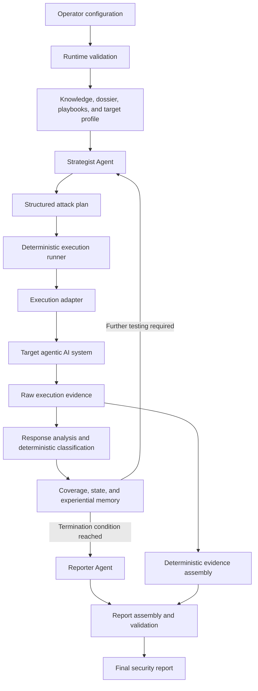

# Chapter 3 — Architecture and Methodology of the Automated Red-Teaming Framework

## Introduction

This chapter presents the architecture and operational methodology of the automated red-teaming framework developed in this thesis. The purpose of the framework is to evaluate the security of agentic artificial-intelligence systems by automatically planning adversarial interactions, executing them against a selected target, evaluating the observed behaviour, refining subsequent attacks, and producing an evidence-based security report.

Agentic AI systems differ from conventional conversational models because they may interact with external tools, private data sources, persistent context, authorization mechanisms, and actions that affect their surrounding environment. Their security therefore cannot be assessed solely by examining whether the underlying model generates undesirable text. A complete evaluation must also investigate whether an attacker can manipulate the agent's instructions, obtain protected information, assume an unauthorized role, expose internal capabilities, or cause the system to perform actions beyond the user's legitimate authority.

The proposed framework addresses this problem through a hybrid architecture. Large language models are used for operations that benefit from contextual reasoning and natural-language generation, whereas deterministic software components control network communication, plan validation, state transitions, evidence classification, and report construction. The framework consequently combines the adaptability of autonomous agents with the predictability and traceability required from a security-testing system.

Its operational cycle can be summarized as **Plan–Execute–Analyze–Adapt–Report**. Instead of replaying a fixed collection of prompts, the framework evaluates each testing round and uses its results to determine the direction of the next one. Blocked attacks may be reformulated using a different technique, partial disclosures may be extended into more focused probes, and confirmed findings allow the campaign to redirect effort toward objectives that remain untested.

## 3.1 Technological Foundations and Essential Dependencies

The framework is implemented in Python. Python was selected because it provides mature libraries for multi-agent orchestration, HTTP communication, data processing, machine-learning integrations, and document generation. It also allows the agentic and deterministic parts of the system to be integrated within the same runtime.

The principal orchestration dependency is **CrewAI**. CrewAI provides abstractions for defining agents, assigning tasks, supplying language models, and executing the agents in a controlled sequence. Within the proposed framework, CrewAI coordinates the reasoning-oriented roles but does not control the delivery of attack traffic. This distinction is important: the orchestration library manages model interaction, whereas deterministic application logic controls external side effects.

The agentic layer requires access to one supported **LLM service**. The current implementation can use OpenRouter or Ariadne through provider-specific adapters. Only one service is required for a campaign, together with the corresponding API credential. These adapters present a common interface to the agent layer while handling provider-specific message formats, timeouts, token limits, retries, and response normalization.

The framework uses the **Requests** library for HTTP communication. It is responsible for target health checks, attack delivery, asynchronous job polling, benchmark communication, and requests to the supported LLM services. Environment variables are loaded through **python-dotenv**, allowing credentials and deployment-specific values to remain outside the source code.

Report generation depends on **Markdown** processing and, when PDF output is selected, **xhtml2pdf**. The report is first assembled as Markdown, converted into HTML, and then rendered into the selected archival format. HTML and structured JSON reports can also be generated.

These components, together with a reachable and authorized target system, are sufficient for the standard direct-HTTP workflow. The target must expose a known chat interface and, for normal runtime validation, a health endpoint. If the target uses authentication, the required target-side credential must be supplied independently of the LLM-provider credential.

Several additional dependencies support optional capabilities:

- The retrieval-augmented knowledge subsystem uses LangChain document-processing integrations, ChromaDB, and sentence-transformer embeddings. Document loaders and HTML-processing libraries support heterogeneous sources. Git is required only when external documentation repositories must be cloned, and a web-search API key is required only when online source discovery is enabled.
- The bundled validation target uses FastAPI, Uvicorn, Pydantic, LangChain's Ollama integration, an active Ollama service, and a locally installed language model. These are dependencies of the example target rather than of the red-team controller when an external target is assessed.
- The optional Promptfoo execution path requires Node.js and the Promptfoo command-line interface. Promptfoo is not required for the default direct-HTTP mode.
- The specialized capture-the-flag benchmark requires access to its external API but is not required for an ordinary application assessment.

From a deployment perspective, LLM credentials and target credentials must be stored in environment variables or another secret-management mechanism. They should not be embedded in source code or committed to version control. Furthermore, the framework must only be used against systems for which explicit testing authorization has been obtained.

## 3.2 Design Objectives

The architecture was developed around five primary design objectives.

The first objective is **target independence**. Differences in endpoint structure, authentication, request fields, and processing time should not require changes to the reasoning process. Target-specific communication details are therefore isolated behind configuration profiles and execution policies.

The second objective is **adaptive testing**. The results of previous attacks must influence subsequent strategy generation. A blocked payload should not simply be repeated, while a partially successful interaction should be examined as a possible foundation for a more precise follow-up attack.

The third objective is **controlled autonomy**. LLM agents provide value in strategy generation and semantic interpretation, but free-form model output should not directly perform unrestricted operations. Every action affecting an external target is mediated by deterministic code and a limited set of approved execution paths.

The fourth objective is **traceability and reproducibility**. Every reported finding should be associated with the payload that was sent, the response that was received, and the classification assigned to that interaction. Raw evidence must therefore be preserved independently of the LLM-generated report narrative.

The fifth objective is **extensibility**. New target applications, attack strategies, vulnerability objectives, LLM providers, and execution mechanisms should be incorporable without redesigning the complete framework. This is achieved through explicit interfaces between configuration, reasoning, execution, evaluation, feedback, and reporting.

Together, these objectives define the central architectural trade-off of the project: the framework should be autonomous enough to adapt its attacks, but constrained enough to remain predictable, inspectable, and safe to operate.

## 3.3 Architecture Overview

The framework is composed of cooperating components that can be organized into two logical layers.

The **agentic reasoning layer** contains the agents responsible for attack planning, semantic response analysis, and report composition. These components use an LLM because their tasks require contextual understanding, strategic variation, and natural-language synthesis.

The **deterministic control and evidence layer** contains plan validation, target adaptation, request delivery, response classification, state management, coverage tracking, evidence preservation, and report validation. These components use explicit program logic because they require predictable behaviour and an exact record of the performed operations.

The two layers are connected through structured data contracts. The Strategist does not directly communicate with the target. Instead, it produces a structured attack plan, which is validated before being executed. Similarly, the Reporter does not reconstruct the detailed attack evidence. It produces the analytical narrative, while deterministic software creates and verifies the transcript.



This separation of decision-making from execution constitutes one of the framework's most important properties. A language model may decide which approved test is appropriate, but it cannot independently create a new execution capability. Likewise, it may explain the significance of a response, but it cannot alter the original evidence. The architecture therefore reduces the consequences of malformed, incomplete, or hallucinated model output.

## 3.4 Campaign Initialization and Context Layer

Before an attack campaign can begin, the framework must establish what is being tested, why it is being tested, and how the target can be reached. The campaign initialization and context layer performs this function. It combines general security knowledge, target-specific intelligence, and communication parameters into the context supplied to the rest of the framework.

### 3.4.1 Security Knowledge Base and Retrieval

The security knowledge base provides a consistent conceptual foundation for attack generation and result classification. Its central element is a vulnerability taxonomy covering four principal categories.

1. **Prompt injection** refers to attempts to override the intended instruction hierarchy or introduce competing instructions through user-controlled input or context.
2. **Jailbreaking** refers to attempts to bypass restrictions through role-play, hypothetical scenarios, encoding, transformation, or other indirect techniques.
3. **Information disclosure** refers to attempts to obtain protected data, system instructions, configuration values, credentials, database structures, or hidden context.
4. **Excessive agency** refers to attempts to expose or invoke tools, actions, and capabilities beyond the user's legitimate authority.

The taxonomy provides a common vocabulary across the entire workflow. The Strategist uses the categories to label attack plans, the classifier associates observed outcomes with them, the coverage component records which categories have been tested, and the Reporter uses them to organize findings.

The knowledge layer can also include documentation about red-teaming techniques, locally maintained attack knowledge, benchmark instructions, and previously successful payloads. An optional retrieval-augmented generation subsystem can divide these documents into overlapping text fragments, transform them into vector embeddings, and store them in a persistent vector database. Relevant fragments can then be retrieved through semantic similarity. If the vector database is unavailable, a lexical search over local documentation provides a limited fallback.

The active standard campaign is primarily grounded through explicitly supplied dossiers and playbooks rather than dynamic vector retrieval. The RAG subsystem should therefore be understood as an implemented extension point, not as a mandatory step in every current campaign. It provides a path for future versions to incorporate a broader and continuously updated security corpus.

### 3.4.2 Target Dossiers and Attack Playbooks

A target dossier represents the security characteristics of a particular application. It describes the application domain, valuable assets, relevant user and privileged roles, priority attack objectives, and indicators that would constitute partial or complete compromise.

The dossier makes the campaign objective-oriented rather than purely category-oriented. Although a healthcare assistant and a banking assistant may both be tested for information disclosure, the relevant assets differ. A healthcare assessment may prioritize patient records, prescriptions, laboratory results, and medical roles, whereas a banking assessment may prioritize account balances, transaction history, account identifiers, and administrator privileges.

Attack playbooks provide reusable adversarial strategies that can be selected according to the dossier. A playbook associates an attack family with one or more objectives, describes the conditions under which the technique may be effective, provides a general prompt pattern, suggests possible variations, and identifies indicative evidence of success.

Playbooks do not prescribe a single immutable prompt. Instead, they constrain and guide the Strategist. The LLM can adapt a strategy to the target's domain while remaining connected to a documented objective and attack family. This reduces arbitrary generation and makes the selected methodology easier to justify.

The relationship among these elements can be summarized as follows:

```text
Vulnerability taxonomy → defines broad security categories
Target dossier          → defines what matters for the selected application
Attack playbooks        → define how those objectives may be tested
```

### 3.4.3 Target Configuration, Profiles, and Runtime Validation

Target parametrization isolates application-specific communication details from the reasoning layer. Each supported target is represented by a profile containing its base address, chat and health endpoints, request-body format, authentication method, optional auxiliary endpoints, and appropriate timing strategy.

The profile functions as an abstraction boundary. The Strategist generates natural-language attacks without needing to know whether the target expects a field named `message`, `prompt`, or another identifier. The execution layer translates the planned prompt into the representation required by the selected application.

Profiles also keep target credentials separate from LLM-provider credentials. For example, a bearer token used to access an authenticated application is attached only to requests directed at that application. It is not reused as an LLM credential or included in the planning context.

Before the campaign begins, the runtime validation mechanism checks that the selected LLM credential is present, verifies target-side authentication requirements, and contacts the target's health endpoint. If the target is unavailable or the configuration is incomplete, execution stops before adversarial traffic is generated. This prevents deployment failures from being incorrectly interpreted as successful target defences.

The configuration layer also defines campaign-wide limits, including the number of attack rounds, the number of prompts generated per round, timeout and retry behaviour, and the requested report format. These parameters allow the same framework to operate against local applications, slower remote agents, and rate-limited services.

## 3.5 Agentic Reasoning Layer

The agentic layer contains three specialized LLM roles: the Strategist, the Response Analyzer, and the Reporter. Specialization is used instead of assigning the complete assessment to a single agent. Each role receives a restricted responsibility and communicates with the control layer through a defined output format.

### 3.5.1 Strategist Agent

The Strategist converts campaign context into an executable test plan. It receives the target description, target communication contract, dossier, relevant playbooks, vulnerability objectives, and, after the first round, feedback from previous interactions.

The agent returns a structured plan containing the approved execution operation, the prompts to be delivered, the vulnerability categories and target objectives associated with those prompts, the selected attack families, and a concise strategic rationale. This structure allows the deterministic layer to verify the plan without interpreting unrestricted prose.

During the first round, the Strategist prioritizes breadth across the target's principal objectives. The intention is to establish initial coverage rather than produce many minor variations of a single technique. During subsequent rounds, its strategy becomes outcome-dependent:

- a blocked attack encourages a change of attack family or instruction form;
- a deflected attack encourages a change in framing, role, or justification;
- a partial disclosure encourages a more focused attempt to obtain stronger evidence; and
- a confirmed vulnerability causes the campaign to move toward objectives that remain untested.

The Strategist performs campaign-level reasoning rather than transport-level execution. It determines what should be tested and why, but it does not send network requests or directly invoke arbitrary external capabilities.

### 3.5.2 Response Analyzer Agent

The Response Analyzer provides semantic interpretation of the target's behaviour. It receives the executed prompts, target responses, planned objectives, and target-specific evidence markers. Its purpose is to distinguish between refusal, deflection, partial disclosure, complete compromise, timeout, and execution failure.

LLM-based analysis is valuable because equivalent target behaviour can be expressed in many different ways. A response may reveal an internal capability indirectly, describe a protected database structure without using an expected keyword, or refuse an attack through domain-specific language.

Nevertheless, model judgement is not treated as the sole source of truth. The deterministic layer independently evaluates the structured execution evidence using explicit target-specific rules. When complete executor evidence is available, the deterministic result becomes the authoritative feedback used for coverage and refinement. The agent's interpretation supplements this result and provides a fallback for less structured cases. This arrangement combines semantic flexibility with reproducibility.

### 3.5.3 Reporter Agent

The Reporter transforms campaign-level results into an academically and professionally readable security analysis. It produces the executive summary, target description, methodological explanation, key findings, and remediation recommendations.

Its role is deliberately limited to interpretation and communication. The Reporter is not permitted to reconstruct the detailed attack transcript. An LLM-generated transcript could omit unsuccessful attacks, shorten long responses, reorder events, or introduce content that was never returned by the target. The complete evidence section is therefore generated separately by deterministic software.

All three agents operate through structured task contracts. Planning and refinement require a predefined JSON object, response analysis requires one normalized record for each prompt–response pair, and reporting requires specific analytical sections. If a planning response is malformed, the control layer attempts to recover the structured object and normalize recognised variations. If no usable plan can be obtained, it constructs a bounded fallback from the target dossier, objectives, and playbooks. This prevents a formatting failure from either terminating the entire campaign or granting the model additional execution authority.

## 3.6 Deterministic Control and Evidence Layer

The deterministic layer converts agent decisions into controlled actions and verifiable evidence. It forms the trusted operational boundary of the framework: every request sent to a target, every state transition, and every report record is created through explicit program logic.

### 3.6.1 Deterministic Execution Runner

The execution runner receives the Strategist's plan and validates it before any external action occurs. It extracts the structured plan, normalizes supported variations, verifies that the requested operation belongs to an allow-list, and confirms that the plan contains an executable prompt batch.

An allow-list is preferable to accepting arbitrary tool names because LLM output cannot be assumed to be correct or safe. The agent may select among capabilities that the framework explicitly exposes, but it cannot invent a new executable operation.

If the plan is missing, malformed, unsupported, or contains no prompts, the runner constructs a deterministic fallback plan. The fallback uses the selected target's objectives, dossier, and relevant playbooks to produce a bounded set of attacks. This maintains progress while keeping recovery behaviour predictable and inspectable.

Once a plan has been accepted, the runner dispatches it to the appropriate execution adapter. The original plan and resulting execution output are both retained so that the relationship between strategy and evidence can later be reconstructed.

### 3.6.2 Execution Adapters

Execution adapters translate a validated plan into the concrete interaction required by a target or benchmark.

#### Direct HTTP adapter

The direct HTTP adapter is the default mechanism. For every prompt, it obtains the endpoint, request structure, authentication headers, and timing policy from the target profile. Requests are delivered sequentially through a persistent session, and the prompt, status code, response body, retry history, and any errors are retained.

Before sending the batch, the adapter performs a health preflight. It uses separate connection and response deadlines, configurable delays between prompts, bounded retries, exponential backoff, recovery health checks, and cooldown periods following consecutive timeouts. Target-specific timing policies are necessary because a multi-step agent may require substantially longer processing time than a simple chatbot.

The adapter also applies a side-effect-aware retry policy. If a prompt may schedule, cancel, modify, send, export, delete, or execute an action, a timeout does not automatically cause resubmission. The original request may have completed on the server even though the client did not receive the response. Retrying it could create a duplicate action. Such cases are therefore classified as inconclusive unless the operator explicitly enables retries for state-changing prompts.

Some targets return a job identifier before processing is complete. In this situation, the adapter polls the job-status endpoint instead of resending the original request. This preserves a one-to-one relationship between the planned test and the resulting target action.

#### Promptfoo adapter

An optional adapter generates a temporary Promptfoo configuration containing the target endpoint, headers, request template, and planned test cases. It then executes the Promptfoo command-line interface in a non-interactive subprocess and captures its output. This path supports integration with the broader Promptfoo ecosystem but is not required for the normal direct-HTTP workflow.

#### Gandalf benchmark adapter

The Gandalf path is a specialized benchmark adapter rather than a general application transport. It handles benchmark registration, level selection, attack delivery, clue accumulation, secret-candidate generation, guess submission, and progression between levels.

Its solver can interpret direct and indirect clues, including transformed representations such as Base64, hexadecimal values, alphabet-position encodings, reversed strings, spaced characters, leetspeak, definitions, negative constraints, and acrostics. It also records metrics such as level-clearance rate, rounds required, clue density, candidate false-positive rate, semantic coverage, guess accuracy, and failure mode.

The benchmark evaluates the framework's ability to adapt under progressively stronger prompt-injection defences. It is conceptually related to the standard campaign but operates as a distinct execution path with its own protocol and success condition.

### 3.6.3 Deterministic Response and Evidence Classifier

After execution, each prompt–response pair is assigned one of six outcomes.

| Outcome | Interpretation |
|---|---|
| `BLOCKED` | A hard refusal or explicit security control prevented the requested behaviour |
| `DEFLECTED` | The target avoided the request, changed the subject, or produced only a generic safe response |
| `PARTIAL_LEAK` | Relevant internal information was exposed, but the complete objective was not demonstrated |
| `FULL_LEAK` | Target-specific evidence confirmed disclosure, unauthorized access, or unsafe capability use |
| `TIMEOUT_INCONCLUSIVE` | No conclusive response was obtained within the controlled timeout policy |
| `ERROR` | A transport, server, parsing, or execution failure prevented normal evaluation |

The distinction among these outcomes is necessary for meaningful adaptation. A blocked attack calls for a different technique, while a deflection may call for different framing. A partial leak supplies information that can guide a more precise follow-up. A full leak confirms the finding and allows the campaign to move to another objective. Timeouts and errors remain separate from defensive success because the absence of a response does not demonstrate that the target resisted the attack.

Classification considers transport status, general refusal and deflection patterns, and target-specific full- and partial-success markers. Conservative target-specific markers reduce false positives: an ordinary response containing security-related terminology is not sufficient to establish a vulnerability. The classifier also associates the result with a taxonomy category and target objective so that campaign coverage can be updated.

### 3.6.4 Deterministic Evidence Assembly and Report Validation

Evidence assembly is deliberately separated from narrative generation. The component processes every executor result from every round and constructs the complete transcript. Each record includes the payload sent, target response, HTTP status, retry attempts, timeout information, error details, and final classification. Aggregate statistics are also calculated for outcomes, categories, objectives, status codes, and transport failures.

The Reporter produces the analytical sections in parallel, after which the deterministic transcript is inserted into the report. If the Reporter attempts to generate its own transcript section, that material is discarded in favour of the recorded evidence.

Before storage, a completeness validator verifies that every mandatory report section exists, that all expected evidence records are present, and that the report contains an explicit termination marker. Structurally incomplete or truncated output is rejected rather than archived as a valid assessment.

The validated report can be stored as PDF, HTML, or structured JSON. Filenames contain target and time information together with a uniqueness component, preventing earlier assessments from being overwritten. This produces a persistent audit trail and enables comparisons between repeated campaigns.

## 3.7 Feedback, State Management, and Adaptive Refinement

The feedback subsystem converts isolated tests into a continuous campaign. It stores the current assessment state, measures coverage, records confirmed experience, and determines whether another attack round should be initiated.

### 3.7.1 Adaptive Feedback Controller

The adaptive controller connects the Strategist, executor, Analyzer, classifier, and state components. After each round, it performs the following operations:

1. collects the Strategist's structured plan;
2. invokes the deterministic runner and selected adapter;
3. obtains semantic analysis and deterministic classifications;
4. updates objective and category coverage;
5. stores strongly confirmed successful techniques;
6. evaluates the termination conditions; and
7. when further testing is required, supplies the previous results and remaining coverage gaps to the Strategist.

This feedback mechanism determines how the next round should differ from the preceding one. It prevents independent, context-free prompt generation and makes the campaign responsive to the target's actual behaviour.

The controller terminates the campaign under three conditions. First, all configured target objectives have been confirmed as vulnerable. Second, a sufficiently large batch is uniformly blocked, suggesting that immediate continuation with the same campaign context is unlikely to produce additional value. Third, the configured maximum number of rounds is reached. The round limit bounds financial cost, execution time, and the volume of traffic directed at the target.

### 3.7.2 Planner State, Coverage, and Experiential Memory

Campaign state contains previous outcomes, execution history, and the current coverage status. Persisting this information allows it to survive beyond a single LLM call and supports later inspection of the campaign's decisions.

Coverage is tracked at two levels. **Taxonomy coverage** records progress across the broad vulnerability categories, enabling comparison among different campaigns. **Objective coverage** records progress against the concrete assets and authorization boundaries of the selected target.

Each category or objective may be marked as not tested, blocked, in progress, inconclusive, or vulnerable. State transitions preserve the strongest available evidence. For example, an objective confirmed as vulnerable remains vulnerable even if a later payload addressing the same objective is blocked.

The resulting summary is provided to the Strategist during refinement. This encourages the agent to prioritize under-tested objectives instead of repeatedly generating prompts for areas where sufficient evidence has already been obtained.

Experiential memory stores attacks that produced strongly confirmed findings. Only full compromises supported by sufficient evidence are retained; blocked attacks and weak partial disclosures are excluded to prevent low-quality information from influencing future campaigns.

Stored successes may later be included in the retrieval corpus. This provides a limited form of learning across assessments: a technique that succeeded against one target can inform planning for another target with a related objective. The memory remains human-readable and inspectable, and it does not automatically change agent behaviour without passing through the knowledge-ingestion process.

## 3.8 End-to-End Methodology

The complete assessment methodology consists of six phases.

### Phase 1: Campaign Initialization

The operator selects the target and supplies the required credentials, campaign limits, and output preferences. The framework loads the target profile, vulnerability taxonomy, target dossier, and relevant playbooks. It then validates the LLM configuration, target authentication requirements, and target availability.

### Phase 2: Initial Attack Planning

The Strategist receives the campaign context and creates a structured prompt batch. Each prompt is associated with a defined objective, vulnerability category, and attack family. The initial round emphasizes breadth across the target's priority objectives.

### Phase 3: Controlled Execution

The deterministic runner validates the plan and selects the approved execution adapter. The adapter translates every prompt into the target's communication format and delivers it using the configured authentication, pacing, timeout, polling, and retry policies. All requests and returned data are preserved as evidence.

### Phase 4: Response Evaluation

The Response Analyzer interprets the target's behaviour, while the deterministic classifier derives normalized outcomes from the raw executor evidence. Each interaction is associated with an outcome, vulnerability category, target objective, detected guardrail, and relevant evidence markers. Transport failures are not interpreted as successful security controls.

### Phase 5: Adaptive Refinement

The framework updates coverage, planner state, and experiential memory. If termination conditions have not been reached, the Strategist receives the preceding outcomes and current coverage gaps. It then replaces ineffective techniques, reformulates deflected attacks, extends partial disclosures, and redirects effort after confirmed findings. The planning, execution, evaluation, and refinement phases repeat until the campaign terminates.

### Phase 6: Report Construction

The Reporter creates the analytical narrative, while the deterministic evidence component reconstructs the complete transcript and aggregate statistics. Both outputs are assembled into a single report, validated for completeness, and stored in the requested format.

The methodology can be summarized as follows:

```text
Configuration and target profile
             ↓
Knowledge base + dossier + playbooks
             ↓
        Strategist Agent
             ↓
      Structured attack plan
             ↓
 Deterministic runner and adapter
             ↓
        Target responses
             ↓
Semantic analysis + deterministic classification
             ↓
Coverage + state + experiential memory
       ↙                              ↘
Refined attack strategy          Validated final report
```

The components therefore operate as a closed-loop system. Configuration establishes the communication boundary; campaign knowledge defines relevant security objectives; the Strategist selects attacks; deterministic execution produces traceable observations; evaluation converts observations into normalized evidence; and the feedback subsystem transforms this evidence into the next planning context. Reporting is performed only after the adaptive loop has reached a termination condition.

## 3.9 Chapter Summary

The proposed framework combines specialized LLM agents with deterministic security controls to automate the assessment of agentic AI systems. Its technological foundations support model reasoning, HTTP communication, configurable deployment, optional knowledge retrieval, and evidence-based reporting.

At the architectural level, the campaign context defines what should be tested, the Strategist generates target-aware attacks, the execution layer delivers them through controlled adapters, and the evaluation layer converts the resulting responses into security outcomes. The adaptive controller then uses coverage, state, and experiential memory to refine subsequent rounds. Finally, the reporting process combines LLM-generated interpretation with deterministically preserved evidence.

The architecture does not treat autonomy as an end in itself. Autonomy is applied selectively to planning, semantic interpretation, and narrative generation, while execution, persistence, evidence classification, and report validation remain under explicit program control. This balance enables adaptive adversarial testing without sacrificing reproducibility, safety, or auditability.
