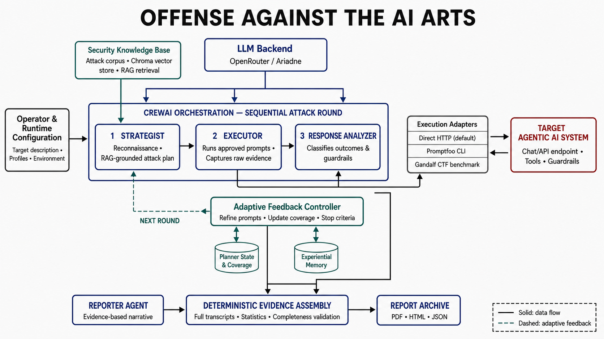

# Offense Against the AI Arts: Framework Architecture

## 1. Purpose and Scope

The framework automates security testing of agentic AI systems by assigning distinct responsibilities to cooperating red-team agents. Its main workflow repeatedly plans attacks, executes them against a configured target, analyzes the responses, and uses the observed outcomes to refine the next attack round. When testing stops, the framework combines an LLM-generated security analysis with deterministically preserved execution evidence and exports an archival report.

The implementation is organized around CrewAI, which runs the agents sequentially. The current vulnerability taxonomy covers prompt injection, jailbreaking, information disclosure, and excessive agency. The same orchestration can target a generic chat API or a predefined target profile such as Zero-Health. Gandalf is supported as a specialized CTF benchmark path.

## 2. Architectural Components

### 2.1 Operator and Runtime Configuration

The workflow starts in `main.py`. The operator supplies a target description through the `--target` command-line argument or `TARGET_PROMPT`. Environment variables select the target profile, chat and health endpoints, authentication method, request format, LLM provider, attack timing strategy, maximum number of rounds, and report format.

Before any attack begins, `validate_runtime()` verifies that the selected LLM credential is present and that the target's health endpoint is reachable. A Zero-Health run also requires a target authentication token. This fail-fast stage prevents configuration failures from being mistaken for target defenses or unsuccessful attacks.

### 2.2 LLM Backend

All four agent roles use a shared LLM backend selected by `LLM_BACKEND`. OpenRouter is the default implementation and Ariadne is retained as an alternative. The wrappers translate CrewAI messages into the provider-specific request format and apply limits such as timeouts, token budgets, retry behavior, and optional reasoning controls.

The LLM provides the reasoning and natural-language generation used by the Strategist, Executor, Response Analyzer, and Reporter. Network requests to the target, state updates, evidence assembly, report validation, and file creation remain under deterministic Python control.

### 2.3 Security Knowledge Base

`ingest_knowledge.py` builds the retrieval corpus from configured repositories and local documents. Current sources include Promptfoo, PyRIT, Agentic Radar, the local vulnerability taxonomy, the Gandalf skill, and accumulated experiential memory. Documents are split into chunks, embedded, and stored in a persistent Chroma vector database.

During planning, `tool_knowledge_rag` retrieves relevant attack techniques from Chroma. If the vector database is absent or unavailable, the framework falls back to lexical search over local knowledge files. This layer grounds attack generation in a security corpus instead of relying only on the model's pretrained knowledge.

### 2.4 Strategist Agent

The Strategist is the planning and reconnaissance role. In the first round it receives the operator's target description and can use four non-destructive discovery tools:

- `discover_target_surface` maps the reachable API surface.
- `infer_target_schema` probes accepted request field names.
- `analyze_target_behavior` sends benign prompts to observe response structure and timing.
- `scan_target_misconfigurations` checks for obvious exposed endpoints and configuration weaknesses.

The Strategist then queries the security knowledge base and produces a structured JSON handoff. For the standard path, the handoff names `execute_promptfoo_attack`, supplies five to eight pipe-delimited prompts, and records the vulnerability categories being tested. In later rounds, the task also receives the previous analyzer feedback and current coverage state, allowing it to change attack families, escalate soft refusals, extend partial disclosures, or move away from already confirmed vulnerabilities.

### 2.5 Executor Agent and Execution Adapters

The Executor consumes the Strategist's JSON plan and invokes the named execution tool. It is deliberately constrained to execution and evidence capture: it must not silently replace the plan or paraphrase the resulting logs.

The standard `execute_promptfoo_attack` adapter has two modes. Direct HTTP mode is the default. It splits the plan into individual prompts, performs a target health preflight, builds the configured request payload and authentication headers, and sends prompts sequentially using a persistent HTTP session. If the target returns a background job identifier, the adapter polls the job endpoint rather than resubmitting the action.

The adapter applies target-specific pacing, connection and read timeouts, bounded retries, exponential backoff, cooldowns, and health checks. Prompts that appear capable of changing server state are not automatically retried by default, because duplicate scheduling, cancellation, email, or export operations could have real side effects. A timeout is recorded as `TIMEOUT_INCONCLUSIVE`, not as evidence that the target resisted the attack.

When `USE_PROMPTFOO=1`, the adapter instead creates a temporary Promptfoo configuration and invokes the external Promptfoo CLI. The repository also exposes Gandalf-specific execution and guess-generation tools. Those tools form an optional benchmark adapter for measuring the framework against the multi-level Gandalf CTF and are not required by the generic target workflow.

### 2.6 Target Agentic AI System

The target is external to the red-team orchestration boundary. It may be the included vulnerable FastAPI chatbot, the Zero-Health application, a compatible remote API, or the Gandalf benchmark. `src/target_profiles.py` isolates endpoint, payload, and authentication differences from the agent logic. Generic targets default to a JSON body containing `message`; the field and request format can be changed without rewriting the attack loop.

This separation is important: the agents reason about attacks, while the adapter layer is responsible for translating those attacks into the target's concrete API contract.

### 2.7 Response Analyzer

After the Executor returns raw results, the Response Analyzer evaluates every prompt-response pair and emits structured JSON. Each result contains the prompt, response, vulnerability category, detected guardrail, and one of the following outcomes:

- `BLOCKED`: a hard refusal or guardrail activation.
- `DEFLECTED`: a soft refusal or topic change.
- `PARTIAL_LEAK`: potentially useful information was disclosed without a complete compromise.
- `FULL_LEAK`: the tested vulnerability was confirmed.
- `TIMEOUT_INCONCLUSIVE`: no response arrived within the controlled retry policy.
- `ERROR`: the request or response could not be evaluated normally.

`extract_feedback()` parses the analyzer's JSON for the next round. It also contains a heuristic fallback classifier for cases where structured agent output cannot be recovered from the CrewAI result.

### 2.8 Adaptive Feedback, Coverage, and Memory

`run_attack_loop()` is the controller for the Plan-Execute-Analyze cycle. After every round it extracts analyzer feedback, updates vulnerability coverage, stores successful attacks, and evaluates the stopping conditions.

`CoverageTracker` maintains a state for each taxonomy category: `not_tested`, `blocked`, `in_progress`, or `vulnerable`. That summary is supplied to the next planning task so the Strategist can prioritize under-tested categories. Planner history and coverage are persisted in `planner_state.json` and its coverage companion file, allowing state to survive process restarts.

`ExperientialMemory` appends confirmed `FULL_LEAK` payloads to a local Markdown log. Because that log is also configured as a knowledge source, successful techniques can later re-enter the RAG corpus and influence future planning.

The loop normally ends when `MAX_ATTACK_ROUNDS` is reached. It may stop earlier when a round contains at least three full leaks or when a sufficiently large set of prompts is uniformly blocked. The dashed return path in the diagram represents this adaptive control flow from analysis back to the next planning round.

### 2.9 Reporting and Evidence Preservation

Reporting is intentionally split into generative and deterministic stages. The Reporter agent receives the final coverage and execution summaries and writes concise Markdown for the executive summary, target details, methodology, key findings, and remediation recommendations. It is explicitly prohibited from recreating the detailed transcript section.

Python independently parses every Executor payload and target response from every round. `build_report_evidence()` produces the complete transcripts, status counts, analyzer outcomes, category counts, transport errors, and evidence markers. `assemble_complete_report()` inserts this material as the detailed evidence section between the analytical findings and remediation sections.

Before export, `validate_complete_report()` verifies that all five required report sections, every evidence marker, and the end-of-report marker are present. This prevents a truncated LLM completion from silently producing an incomplete audit artifact. `save_report()` then writes a uniquely named PDF, HTML, or structured JSON file to the report archive; existing reports are not overwritten.

## 3. End-to-End Operational Sequence

1. The operator selects the target and runtime settings.
2. The entry point validates LLM credentials, target authentication, and target availability.
3. The framework creates the four specialized agents and loads the selected profiles and LLM backend.
4. The Strategist performs reconnaissance and retrieves relevant techniques from the security knowledge base.
5. The Strategist returns a structured attack plan containing the executor tool, prompts, and tested categories.
6. The Executor translates the plan through the selected adapter and sends the prompts to the target system.
7. Raw payloads, HTTP results, target responses, attempts, timing failures, and retry decisions are preserved.
8. The Response Analyzer classifies each result and identifies observable guardrails.
9. The feedback controller updates coverage and experiential memory, then evaluates whether testing should stop.
10. If another round is required, the Strategist receives the previous feedback and coverage summary and produces a refined plan.
11. After termination, the Reporter generates the bounded analytical narrative while Python builds the full evidence transcript and statistics.
12. The application validates completeness and archives the report in the requested format.

## 4. Architectural Properties

The architecture separates decision-making from side effects. Agents decide what to test and how to interpret the result, while Python adapters control actual network traffic, authentication, retry safety, persistence, and report construction. This reduces the risk that free-form model output directly controls sensitive operations.

It also separates interpretation from evidence. The Reporter can summarize and recommend, but it cannot replace the original payloads and responses. This gives the generated report a reproducible audit trail and makes successful, blocked, erroneous, and inconclusive tests distinguishable.

Finally, the target profile and execution adapter boundaries make the framework extensible. New targets can be supported by adding endpoint and payload mappings, and new benchmark or attack engines can be added behind the Executor without changing the Plan-Analyze-Feedback lifecycle.

## 5. Current Implementation Boundary

The diagram represents the active generic workflow plus the integrated Gandalf benchmark branch. A PyRIT execution function exists in `src/tools.py`, but it is not currently registered in the Executor agent's tool list and is therefore not shown as an active adapter. The vulnerability taxonomy and stopping rules are also intentionally compact in the present implementation; extending them is a natural future-work direction rather than functionality assumed by this architecture.
